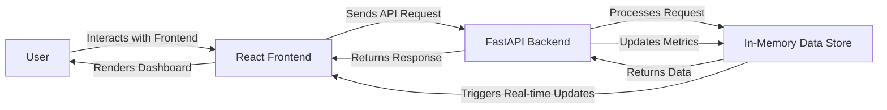

# Executive Summary
The ram-weather-optimizer-portal project aims to optimize Windows 11's built-in Weather app RAM usage by providing real-time metrics and interactive dashboards. The project utilizes a FastAPI backend and a React frontend, with a focus on in-memory data storage and CORS-enabled communication between the two.

## Architecture Overview
The project consists of two primary components: the FastAPI backend and the React frontend. The backend is responsible for handling API requests, storing data in-memory, and providing real-time metrics. The frontend is responsible for rendering interactive dashboards and communicating with the backend via API requests.

### End-to-End System Architecture Flow Diagram

## API Contracts
The FastAPI backend provides the following API endpoints:

* `POST /reset`: Resets the in-memory data store
* `POST /submit-data`: Submits new data to the in-memory data store
* `GET /fetch-data`: Retrieves data from the in-memory data store
* `GET /metrics`: Retrieves real-time metrics from the in-memory data store

## Frontend Component Architecture
The React frontend consists of the following components:

* `App`: The main application component
* `Dashboard`: The dashboard component that renders real-time metrics
* `Form`: The form component that submits new data to the backend
* `Metrics`: The metrics component that displays real-time metrics

## Automated Testing Setup
The project utilizes Pytest for automated testing. The test suite includes tests for the FastAPI backend and the React frontend.

## Step-by-Step Local Running Instructions
To run the project locally, follow these steps:

1. Install backend packages: `pip install -r requirements.txt`
2. Start the backend: `uvicorn backend.app:app --reload --port 8000`
3. Install frontend packages: `cd frontend && npm install`
4. Start the frontend: `cd frontend && npm run dev`
5. Access the frontend: `http://localhost:5173`

Note: CORS is enabled to allow communication between the frontend and backend. This allows the frontend to make API requests to the backend, even though they are running on different ports.